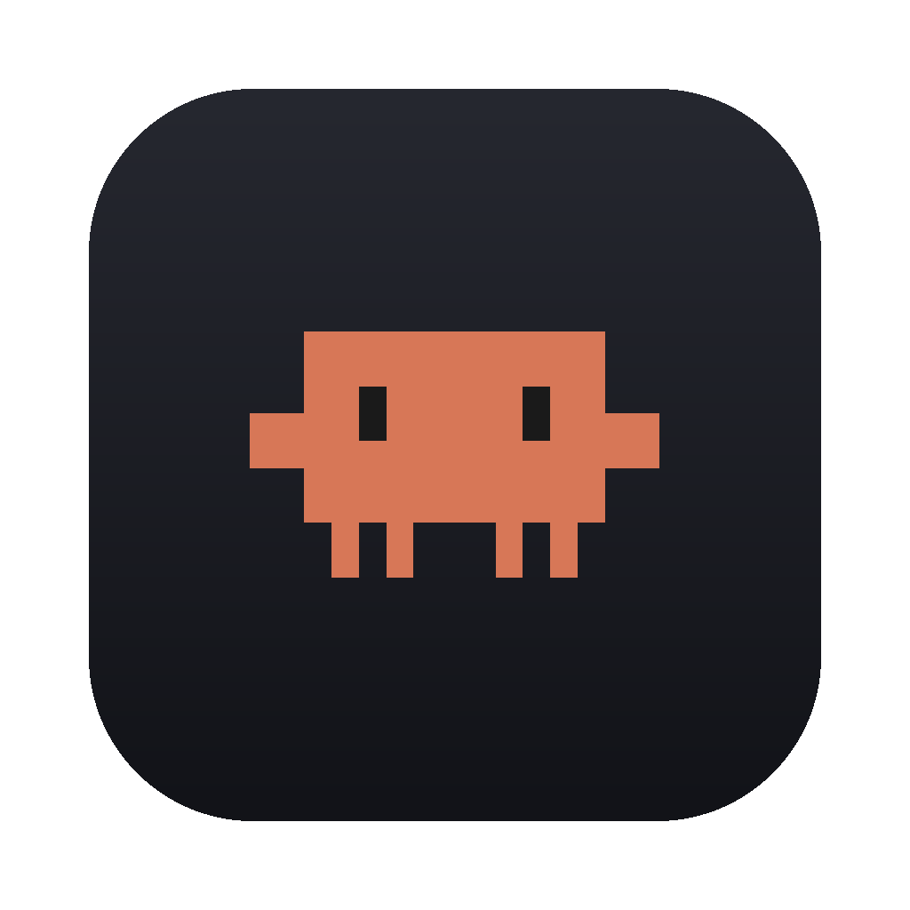

# ClaudePicker

macOS 上的 Claude Code 会话浏览器：一个窗口里看到所有项目的历史会话，点一下就在内嵌终端里 `claude --resume` 接上。



## 它解决什么

在终端里跑 `claude` 时，想接着上次那个会话，得先记住项目路径、翻 `~/.claude/projects` 找 session id，再 `claude --resume <sid>`。ClaudePicker 把这件事做成一次点击：

- 左侧两栏树：项目（按最近活跃排序）→ 会话（标题 + 相对时间 + 会话总结）
- 右侧内嵌终端：点会话即在这个窗口里 `claude --resume`，不用另开 Terminal.app
- 底部状态栏：当前模式 / 模型 / 推理强度 / 快速模式，直接读写 `~/.claude/settings.json`
- 右上角 usage 圆环：读 Claude CLI 的 OAuth 凭据，显示 5 小时与 7 天用量
- 忙闲指示：claude 正在工作时，会话行显示橙色转圈、终端左上角出现「工作中」胶囊；后台会话有新产出时，切回来前会在会话行打绿点

## 环境要求

| 项 | 要求 |
|---|---|
| macOS | 14.0 及以上 |
| 架构 | Apple Silicon（arm64） |
| Claude Code CLI | **必须先装**，ClaudePicker 通过 login shell 从 `PATH` 调用 `claude` |
| 已登录 | CLI 需完成登录（`~/.claude/` 下已有会话与凭据） |

装 CLI：

```bash
npm install -g @anthropic-ai/claude-code
claude   # 首次运行按提示登录
```

## 安装

### 方式一：下载 DMG / ZIP

从 [Releases](../../releases) 下载最新 `ClaudePicker-x.y.z.dmg`，打开后把 **ClaudePicker** 拖进「应用程序」文件夹（安装后显示名为 Claude Code）。

首次打开会被 Gatekeeper 拦下（应用使用 ad-hoc 签名，没有 Apple 开发者公证）。任选一种放行：

```bash
# 方式 A：右键点图标 → 打开 → 再点"打开"
# 方式 B：命令行去掉隔离标记
xattr -dr com.apple.quarantine /Applications/ClaudePicker.app
```

### 方式二：从源码构建

```bash
git clone https://github.com/zeng-66/claude-picker.git
cd claude-picker
./scripts/build-app.sh --dmg     # 编译 + 组 app + 图标 + 签名 + 出 dmg
open dist/ClaudePicker.app
```

需要 Xcode Command Line Tools（`xcode-select --install`）。SwiftTerm 已 vendored 在 `SwiftTerm/`，无需联网拉依赖。

## 用法

| 操作 | 效果 |
|---|---|
| 点击项目行 | 展开 / 折叠该项目的会话 |
| 点击会话行 | 右侧内嵌终端执行 `claude --resume <sid>` |
| `⌘B` | 显示 / 隐藏侧边栏 |
| `Tab`（树态） | 进入终端，开始输入 |
| `⌘Esc`（终端态） | 关闭终端，回到树 |
| `⌥Esc`（终端态） | 释放焦点但不关闭终端 |
| `Tab` / `Shift+Tab`（终端态） | 透传给 claude（`Shift+Tab` 循环权限模式） |
| 方向键 `↑↓` | 在树里移动光标 |
| `→` / `←` | 展开 / 折叠项目 |
| `Enter` | 打开光标所在会话 |
| `⌫` / `⌦` | 隐藏光标所在会话（写入 `tree.json` 的 `hiddenSessions`） |
| `Esc` | 离开终端焦点 |
| 拖动会话行 | 调整会话顺序 |
| 拖动两栏之间的分隔线 | 调整侧边栏宽度（250–560） |

误删会话的恢复：编辑 `~/.local/share/claude-picker/tree.json`，从 `hiddenSessions` 里删掉那个 session id，重启应用即可。

## 状态栏与 Claude 配置的联动

状态栏四项直接映射 `~/.claude/settings.json`：

| 状态栏 | 配置键 | 备注 |
|---|---|---|
| 模式 | `permissions.defaultMode` | `manual` 写回时落为 `"default"` |
| 模型 | `model`（顶层） | 存别名，如 `claude-opus-4-5-20251101` |
| 强度 | `modelSettings["<canonical-model-id>"].effortLevel` | 键必须是 canonical id；`max` 会被静默降级为 `medium` |
| 快速模式 | `fastMode` | 只通过 `/fast` 斜杠命令生效，不进启动参数 |

在下拉里改动会立刻写盘；反之在终端里跑的 `/model`、`/effort` 不写盘，所以窗口重新激活时会重读一次 settings。

## 数据来源

会话不是缓存，是**每次启动实时扫描**：

```
~/.claude/projects/<编码后的项目路径>/<session-id>.jsonl
```

每个文件只读前 128 KB 取标题，标题只认 `type == "user"`、非 sidechain、`origin.kind == "human"` 的第一条人类消息。

会话总结来自 jsonl **尾部 64 KB**：优先取 Claude Code 追加的会话标题记录（新版 `{"type":"summary"}` / 2.1.x 的 `{"type":"ai-title"}`，取最后一条）；没有该记录时总结行为空，只显示相对时间。忙闲判定有两条通道：claude 通过 OSC 0 终端标题写入的 spinner 前缀（`◐ ◑` = 忙，`✳` = 空闲），以及标题通道不可用时（如设置了 `CLAUDE_CODE_DISABLE_TERMINAL_TITLE`）回落到进程 CPU 采样启发式。

## 文件分布

| 路径 | 用途 |
|---|---|
| `/Applications/ClaudePicker.app`（或 `dist/ClaudePicker.app`） | 应用本体 |
| `~/.local/share/claude-picker/tree.json` | 目录 / 会话排序、展开状态、隐藏项 |
| `~/.local/share/claude-picker/settings.json` | 窗口内偏好（终端字号等） |
| `~/.claude/settings.json` | Claude CLI 自身配置（状态栏读写它） |
| `~/.claude/projects/` | 会话数据源 |

## 开发

完整开发文档见 [DEVELOPMENT.md](DEVELOPMENT.md)：源码地图、数据链路、状态机、UI 常量、终端集成、已知坑、迭代 checklist。

快速上手：

```bash
swift build -c release                                   # 构建
./scripts/build-app.sh                                   # 组装 dist/ClaudePicker.app
./scripts/build-app.sh --dmg                             # 额外打 dmg
python3 scripts/make_icon.py build/icon                  # 只重生成图标
```

顶部常量在 `Sources/ClaudeDeck/main.swift` 开头（窗口 1180×700、侧边栏默认 322、最小 250 / 最大 560）。

## 已知限制

- **只支持 arm64**。要通用二进制需在 Intel 机器或交叉编译环境下 `swift build --arch arm64 --arch x86_64`。
- **ad-hoc 签名**，未公证，首次启动需手动放行。
- **不内嵌 Claude CLI**。目标机器上必须自己装好并能跑 `claude`。
- 一台机器同时只保留一个内嵌终端（切换会话会终止上一个）。
- 不支持恢复被隐藏的会话的图形入口，只能改 `tree.json`。

## 许可

应用代码 MIT。vendored 的 [SwiftTerm](SwiftTerm/) 遵循其自身 MIT 许可，见 [SwiftTerm/LICENSE](SwiftTerm/LICENSE)。
