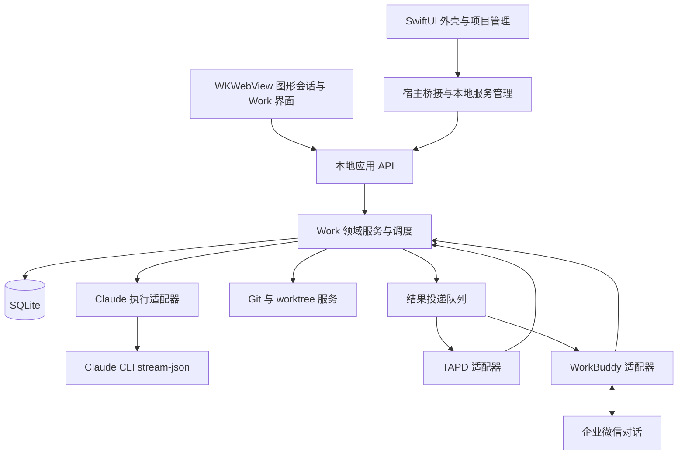

# Claude Picker Agent Workspace 开发说明

版本：2026-11-16。用途：把现有 H5 原型转为 macOS 应用实现的产品和技术基线。

配套文档：

- [交互及按钮规格](INTERACTIONS.md)：逐项定义当前入口、字段、按钮、键盘和拖动。
- [验收与故障场景](ACCEPTANCE.md)：正式功能的验收条件与验证边界。
- [原型运行说明](README.md)：运行方式及演示范围。

## 1. 基线、事实与边界

本文是正式实现的目标契约，不表示以下后端已经实现。事实冲突时，以用户当前明确要求、当前 owning source 和本次实现验证为准，不把历史原型当成运行事实。

| 分类 | 内容 |
| --- | --- |
| 已存在 | SwiftUI/AppKit 外壳、SwiftTerm 会话链路；以当前 `Sources/ClaudeDeck/` 为代码入口 |
| 原型可操作 | 三种布局、项目会话树、图形聊天演示、TAPD 导入、审阅与回填预览、机器人设置、Work 创建及模拟汇报 |
| 原型限制 | `src.js` 内存数据；刷新重置。没有真实 TAPD、企业微信、WorkBuddy、Git、Claude 或 MCP 调用 |
| 正式实现目标 | 本地持久 Work、真实图形会话、可恢复执行、Git 审阅、独立来源接入与结果交付 |
| 尚未验证 | Swttch 在 WKWebView 的完整兼容性；当前 CLI 协议版本；WorkBuddy 接口与企业微信双向通信的实际接入方式 |

本目录是独立原型，不作为生产前端直接打包。生产代码需重新实现领域、持久化与适配边界，不能复用模拟计时器、硬编码路径、示例状态或假验证结果。

### 1.1 已确定的产品决策

1. 保留 macOS 项目/会话外壳与 Git 能力，增加图形聊天和 Work 管理。
2. 图形聊天优先复用 Swttch 的前端/后端链路，通过 Claude CLI 的结构化协议通信。
3. 借鉴 SuperAgent 的持久任务、调度及恢复机制；初期代码执行器仍为 Claude Code，不直接移植 DeepSeek Harness 执行器。
4. Work 是本应用的项目工作项，与 TAPD 需求、任务、缺陷是不同实体。可关联 TAPD，也可由企业微信或本地发起。
5. 企业微信机器人通过 WorkBuddy 与人交流，处理澄清与反馈；代码执行由执行器负责。
6. **WorkBuddy 自动判断工作目录，不配置群聊/机器人到项目的固定映射，不要求用户在创建流程中手选项目。** 不明确时在原对话追问。
7. TAPD 的业务状态、排期与工时独立于 AI 执行状态，不从提交、合并或 AI 自述推断完成、发布、上线及工时。
8. 先有可切换实验入口，真实服务和打包验收通过后再决定默认模式。无需在本次文档阶段选定最终布局。

## 2. 页面与布局

### 2.1 公共外壳

- 标题栏：macOS 窗口控制、侧栏开关、项目入口、分支上下文、工作空间/TAPD/Work/Git 导航、设置。
- 左栏：项目和会话树，Work 中心入口，执行容量及连接状态。
- 主区：图形会话、TAPD 待办、Work 看板或 Git 审阅。
- 右栏：当前 Work/会话的任务详情、变更文件和活动。
- 设置：界面与会话、TAPD 连接、企业微信机器人、MCP。

导航位置保持在标题栏。收起右栏/聊天/左栏不留下空白占位。聊天收起后使用可拖动输入卡片，草稿保留。MCP 管理放在设置，不在聊天顶栏增加重复入口。

### 2.2 三种原型布局

| 布局 | 用途 | 默认表现 |
| --- | --- | --- |
| A 工作空间 | 日常需求开发 | 项目树、会话、右侧上下文 |
| B 任务看板 | 多 Work 管理 | 项目树、分组看板；打开卡片进入对应会话 |
| C 专注对话 | 阅读与讨论 | 项目树、居中会话；详情默认关闭，可恢复 |

底部「布局探索」、左右方向键切布局、URL `variant`、演示状态标签属于原型评审工具，不进入正式应用。正式版可在设置中选择默认布局。

### 2.3 布局规格

- 设计优先覆盖 1280–1600px 桌面窗口；窗口变窄时先隐藏低优先级标题信息，再收起详情，避免挤压输入区。
- 左栏约 212–239px，详情默认 330px，可拖动至 290–520px。以上是初始值，正式版使用逻辑点并按可用宽度约束。
- 聊天列表、详情、文件列表独立滚动。输入区保持可见，用户阅读历史时新消息不强制拉回底部，提供「新消息」入口。
- 切换布局、收起和拖宽不重启会话、不改变 Work 状态；草稿、滚动锚点、提交信息与选中文件按所属上下文保存。
- 继承原 App 的项目独立展开、最多先显示 5 个会话、「展开其余/收起」、项目/会话右键及置顶排序；原型并未完整实现所有右键操作，见交互文档。

## 3. 术语、归属与数据模型

| 实体 | 含义与归属 |
| --- | --- |
| Project | 应用已登记且可访问的本地项目；目录身份由宿主规范化后确定 |
| Work | 项目中的持久工作项，记录目标、范围、执行、等待人处理、证据与交付 |
| Session | 与 CLI 的交互上下文，可恢复；不等同于 Work 数据库 |
| Run | Work 的一次执行尝试；重试生成新 Run，保留前一轮证据 |
| Workspace | 某个 Work 的实际执行目录，通常为独立 Git worktree |
| SourceConversation | 用户发起需求的来源对话，可为企业微信、TAPD 评论线程或本地 |
| InputEvent | 一次消息、审批答复或外部变化，带稳定事件身份并去重 |
| Attention | 必须由人回答的问题或审阅请求；记录与解除均可追踪 |
| Evidence | 实际测试结果、差异、commit/PR 或产物记录，必须关联执行轮次与代码版本 |
| Delivery | 向来源回传结果的独立投递记录；不能等同于 Work 执行成功 |
| TapdRef | workspace、实体类型及完整实体 ID 的关联，可为空 |

### 3.1 建议类型

以下是本项目拟定义的内部类型，不是上游已有 API。

```ts
type WorkStatus = 'queued' | 'running' | 'waiting_user' | 'waiting_review'
  | 'failed' | 'interrupted' | 'completed' | 'cancelled';
type DeliveryStatus = 'not_requested' | 'pending' | 'sent' | 'unknown' | 'failed';
type Origin = 'local' | 'tapd' | 'wecom';

interface Work {
  id: string;                 // 持久 UUID
  displayId: string;          // 如 WORK-1001；数据库事务分配
  projectId: string;
  title: string;
  objective: string;
  scope: string;
  origin: Origin;
  sourceConversationId?: string;
  sourceEventId?: string;
  tapdRefs: TapdRef[];
  status: WorkStatus;
  currentRunId?: string;
  attentionId?: string;
  revision: number;
  createdAt: string;
  updatedAt: string;
}
interface TapdRef {
  workspaceId: string;
  entityType: 'story' | 'task' | 'bug';
  entityId: string;           // 保留完整 ID，不能用页面短号替代
}
interface Run {
  id: string;
  workId: string;
  sessionId?: string;
  workspaceId: string;
  executor: 'claude';
  status: string;
  baseCommit?: string;
  reviewedCommit?: string;
  startedAt?: string;
  endedAt?: string;
}
interface SourceConversation {
  id: string;
  origin: Origin;
  accountId: string;
  remoteConversationId: string;
  remoteThreadId?: string;
  actorId: string;
}
```

约束：Work、Session、Run、外部线程必须分别有身份。queued 仅表示可排队展示，调度器还须校验持久化的 startRequested/执行授权；未请求启动的 Work 不自动执行。一个需求可派生多个项目 Work；一个 Work 可有多个 Run 和相关会话，当前执行 Run 至多一个。首版一个 Work 只在一个项目执行；跨仓库需求拆为相互关联的 Work。`worktree` 是目录隔离，不能用一个 Work 编号代替真实目录。

本地无 Work 的临时聊天允许存在；选择「作为 Work 继续」才创建持久任务。企业微信执行类需求确认目标后必须落为 Work，普通问答不产生空 Work。

## 4. 状态机与操作一致性

### 4.1 Work 主状态

| 当前状态 | 事件及条件 | 新状态 |
| --- | --- | --- |
| 不存在 | 来源有效、项目唯一、目标明确且在已授权范围内 | queued |
| queued | 获得执行槽，准备目录及启动成功 | running |
| queued/running | 缺少业务答复或工具权限 | waiting_user |
| waiting_user | 收到当前问题的有效回答且仍在授权范围 | queued，获得槽后 running |
| running | 有变更/验证证据并产生可审阅结果 | waiting_review |
| waiting_review | 用户接受结果，证据仍对应当前代码 | completed |
| waiting_review | 请求修改或差异已更新 | queued；旧审阅失效 |
| queued/running | 明确失败，结束当前尝试 | failed |
| running | CLI/服务异常中止，结果未确定 | interrupted |
| failed/interrupted | 用户或既定策略批准重试 | queued，新建 Run |
| 未结束状态 | 取消操作完成，执行器已停止 | cancelled |

停止生成与取消 Work 不同：停止当前轮次后进入 `interrupted` 并保留 Work，可恢复；取消是停止该项工作。关闭面板和切换会话不等于停止。首次准备目录失败记为 failed，不能显示为仍在执行。

TAPD 状态不自动跟随此表。Work completed 也不表示已部署。Delivery 独立：Work 可已完成但结果发送失败，仍要在 UI 明确显示「汇报失败，可重试」。

### 4.2 跨任务规则

- 所有异步命令携带 `projectId/workId/runId/sessionId/requestId` 中适用的身份；结果先核验身份，再更新对应对象。
- 切换会话后到达的完成事件更新原 Work，而非当前屏幕选中的 Work。
- 原型的 `state.running`、全局提交状态、5 秒计时不能作为生产实现依据。
- 状态更新使用版本检查；重复点击或重复事件返回已有结果，不重复启动进程、创建 Work 或发送消息。
- 首版默认两个执行槽；实际可执行任务数不得超出配置。等待回答/审阅不占活跃执行槽；仍运行的后台进程需单独登记和管理。

## 5. 技术架构与模块边界



| 模块 | 负责 | 禁止承担 |
| --- | --- | --- |
| AppShell | 窗口、项目树、快捷键、应用设置及宿主生命周期 | 解析 CLI 业务消息、执行任意网页 shell |
| ChatWebView/HostBridge | 嵌入页面及最小原生能力 | 另做一套审批/聊天领域状态 |
| BackendManager | 启动、就绪握手、停止、自有进程归属、崩溃提示 | 仅用端口存在判断服务身份 |
| WorkService | 任务命令、状态和归属、不变量 | 直接调用外部网络并在事务中等待 |
| EventStore/Repositories | Work、Run、来源、证据、inbox/outbox 持久化 | 把全部状态只放 WebView 内存 |
| Scheduler | 并发槽、排队、取消、恢复 | 用 UI 标签推断进程是否存活 |
| ClaudeExecutor | Swttch/CLI 事件转换、工具审批、中断 | 用 PTY 按键模拟结构化控制 |
| WorkspaceService/GitService | 目录验证、仓库规范、差异、暂存、提交及 worktree | 拼接未转义的用户 shell 字符串 |
| TapdAdapter | 当前字段/工作流、读取及受控回填 | 把 AI 状态写成业务完成 |
| WorkBuddyAdapter | 来源消息转换、澄清上下文、结果投递 | 让模型输出路径直接成为文件访问权限 |

Swttch 与 DeepSeek 项目只作为复用及设计来源，固定源码版本、记录本地补丁；Kotlin/JCEF 不进入应用。WorkBuddy 和 TAPD 的连接方式实现前各自验证，避免因为 Codex 内有连接工具就认为独立应用可继承。

### 5.1 当前代码入口与迁移点

- `Sources/ClaudeDeck/TerminalPane.swift`：目前 LocalProcessTerminalView 与 Claude 进程、send、busy、退出等包装。保留原生回退实现，增加独立图形 Session 实现。
- `Sources/ClaudeDeck/main.swift`：当前项目树、panes、会话打开关闭、模型/权限/effort 及 Git 入口。先隔离会话接口，再接图形事件，避免直接把 NSView 类型塞入图形模式。
- `scripts/build-app.sh`：补充静态资源、后端产物、运行时及签名。
- 建议新增模块名：ChatBackendManager、ChatHostBridge、ChatSession、WorkCoordinator。最终路径按实际代码结构定，不为命名重构无关代码。
- `src.js` 的 actions 仅为交互索引，不能直接升级为跨进程权限接口。完整覆盖见 [交互规格](INTERACTIONS.md)。

## 6. 图形会话与执行协议

### 6.1 会话生命周期

新建/恢复时传递规范化项目、执行目录及持久 Session ID。相同项目/Session 不得同时由 SwiftTerm 与图形后端持有执行进程。切换后端需明确结束当前持有者或打开独立会话，不能暗中双启动。

启动后接收确定的 ready 事件才允许发送。发送一条用户消息应分为本地 accepted、送达执行器、开始处理、完成/失败等状态。超时或断线不能自动重发可能已执行的消息。

busy、waiting_user、waiting_review 来自结构化事实，不能以任意输出等同于忙；网页重新挂载不能制造未读或启动信号。后台 Work 产生实际待回答/待审阅时标注未读，查看后消除未读，不清除仍待处理的 Attention。

### 6.2 工具与业务确认

- 工具权限请求具有独立 request ID、工具名、参数、风险范围、有效 Run；只把允许/拒绝结果返回当前请求。
- 业务问题记录问题正文、选项、回答人及答案。默认不预选会改变数据一致性的业务选项；用户可以补充文字。
- 历史审批不能在新 Run、代码变化或更换目标后自动复用。审批已失效时展示状态并获取新请求。
- diff 接受不自动代表工具命令批准；代码审阅、CLI 权限、业务口径是不同操作。
- 模型、effort、fast、权限模式逐项按当前 CLI 支持能力开放。不支持时禁用并说明原因，不显示成功而实际无效。

## 7. 企业微信 / WorkBuddy / 自动工作目录

### 7.1 设置与职责

设置只配置机器人接入所需内容：连接状态、名称、开关、接收范围及允许的来源身份。**不增加群聊项目映射、固定目录或项目选择下拉。** 接收范围及认证字段以 WorkBuddy 实际支持能力为准，不能臆造 token、webhook、回调地址或登录流程。

应用已有项目登记用于本地访问与项目管理，不属于要求用户为机器人另配目录。WorkBuddy 使用对话和宿主提供的可访问项目索引判断目标；模型无需自行获得全盘访问能力。

### 7.2 消息路由

1. 接收事件，确认来源、允许的发起人、会话与接收规则；先持久化并去重。
2. 普通问答直接走对话，不创建 Work。
3. 对明确要求执行的消息，整理目标、范围和候选项目。
4. 已有关联 Work 的跟进，优先关联该 Work；同群讨论另一项目时允许创建新 Work，不把整个群永久锁定到原目录。
5. 当明确引用多个已有 Work 或项目而归属不唯一时，在原对话澄清。仅“最近活跃”不足以确认目标。
6. 生成目标明确的 Work 意图；在已有授权内创建本地 Work，记录来源消息和目录判定依据。若流程有确认卡，其用途是确认工作目标及执行范围，而非要求用户配置目录。
7. 将创建回执交给 WorkBuddy，后续回答、审阅与结果都回到同一来源身份。

### 7.3 目录判定契约

```ts
interface WorkIntent {
  objective: string;
  projectId?: string;            // 只能指向宿主提供的已知项目
  relatedWorkId?: string;
  resolution: 'resolved' | 'needs_clarification';
  evidence: string[];            // 例如显式项目名、明确 Work 引用
  question?: string;
}
```

- 宿主维护项目 ID、展示名、规范根目录及可用状态；索引只提供必要元数据，排除认证信息和无关文件。
- WorkBuddy 返回项目 ID/依据，宿主验证登记、访问权限、仓库身份及符号链接后的实际位置。
- 项目缺失、重名、多个候选、目录不可访问均不静默猜测；在来源会话追问或提示先通过正常项目入口登记目录。
- 人回复后补充本次 Work/对话上下文，不生成固定群聊映射。
- 目录明确不等同于自动批准所有写入操作，执行范围仍按 Work 授权与仓库规范处理。
- H5 当前仅用名称匹配模拟上述流程，**没有真实语义解析、目录扫描或 WorkBuddy 自动选目录实现**。

### 7.4 原会话反馈

创建、需要回答、待审阅、失败、完成是可汇报事件；无变化不重复播报。发送体带 Work 编号、项目、简明结果及应用可处理的链接。链接只能定位 Work，不能携带长效凭据或直接执行批准操作。

收到回答须校验来源身份、Work、Attention 与当前版本；同群里另一人的普通发言不自动当作批准。无法唯一关联时先澄清。消息编辑、撤回和迟到回复不能覆盖已经完成的决策。

外部投递通过 outbox。服务没有明确幂等保证时不承诺 exactly-once；超时结果未知记为 unknown，先核对再重试，不连续刷群。发不出去不会把真实执行结果改成失败，也不能显示「已回复」。

## 8. TAPD 融合

### 8.1 读取与导入

连接独立配置，展示我的待办、项目筛选、标题/编号搜索、详情、负责人、迭代、排期、描述、附件及评论。分配给我的列表必须标为待办，不能当成项目所有需求。

列表分页、限流退避、超时重试及附件失效重取由 TapdAdapter 负责；附件未读取或无法访问要明确标记，不能假装已理解。自定义字段先读字段配置，状态先读工作流。

导入关联完整 TapdRef，创建本地 Work。已有来源的重复导入先展示已有关联 Work，可打开或明确新建一轮，不静默重复启动。TAPD 项目可对应多个本地仓库；这类映射独立于企业微信，不用于 WorkBuddy 的固定群聊路由。

### 8.2 变更与回填

保存需求快照及更新时间/hash。需求更新后展示差异，影响验收/范围时等待确认，不暗中覆盖正在执行的目标。重新读取目标字段，识别人修改的冲突；若接口缺少条件写入，注明尽力检查不能保证原子比较更新。

回填先生成可编辑草稿，展示目标项目、实体、评论正文、拟修改字段和证据。添加评论和流转状态分开执行；字段权限或工作流不允许时说明原因。写入后回读，失败或结果未知都保留待处理记录。

缺少证据的工时、完成时间及上线状态不写入。`代码提交`、`PR 合并`、`本地测试通过`不能独自触发业务完成。企业微信独立 Work 默认没有 TapdRef，不显示 TAPD 回填入口；后续明确关联后才提供相应动作。

## 9. Git、审阅与交付

- 读取 Git 状态与 diff 时固定项目/worktree；切项目后迟到结果不能覆盖当前页面。
- 文件列表显示相对路径与增删统计；支持文本差异，二进制、重命名、删除、大文件和冲突给出对应视图。
- 暂存针对显示的路径和当前 diff 版本，Git 返回成功后刷新 index。取消暂存不等于丢弃修改。
- 创建提交只提交当前 Work worktree 的实际 index，不自动 stage 无关文件，不默认 push。提交信息非空，提交钩子失败显示结果并保留信息。
- 接受审阅记录 tree/diff hash 或准确 commit；有新变更后原批准失效。审阅不要求必须先提交，但交付记录须明确是未提交 tree 还是 commit。
- 确认交付使 Work completed；TAPD 回填和企业微信投递各自追踪结果。生产界面不能像原型一样通过发送评论本身推断工作成功。
- 取消或失败不自动删 worktree/分支。清理需检查未提交文件、活动进程和引用，仅在用户明确选择后执行。

## 10. 持久化、事件及恢复

建议首版使用应用自有 SQLite 数据库，单一后端写入，事务更新状态与 effects/outbox。表至少包括 projects、works、runs、sessions、source_conversations、input_events、attentions、evidence、deliveries、effects、settings。

- 关键唯一键：来源账户/会话/远端事件 ID；外部无事件 ID 时才用稳定内容标识并记录限制。
- Work 编号并发分配不冲突；创建事件、Work 与创建回执排队在同一事务完成。
- 草稿与布局按项目/会话保存，主领域状态不能仅在 WebView localStorage 中保存。
- 执行副作用在事务提交后领取并运行，有 lease/fencing 和次数/退避；租约失效不代表之前副作用一定未执行。
- 重启先恢复数据库，再核对自有进程与 Session。未知进程结果进入 interrupted，不能无条件重放上一条用户消息或有副作用命令。
- 断线重连先获取快照，再从事件游标衔接；游标有缺口重新拉快照。事件序号去重，不能对全局简单累加。
- 停止接收机器人新工作不删除已接受 Work；已有执行与结果投递的继续/暂停策略在开关旁明确说明。首版定义为停止新接收、保留既有 Work，由用户在 Work 中控制执行。

## 11. 本地 API 与宿主桥接

以下是拟定义的内部命令，不是 WorkBuddy/Swttch 现成接口。所有请求包含协议版本、请求 ID、作用域及适用 revision，返回 accepted、rejected、conflict 或已存在的幂等结果。

| 命令 | 关键输入 | 成功事实 |
| --- | --- | --- |
| `project.list` | 过滤与分页 | 当前可用项目索引 |
| `work.create` | intent、来源事件、项目、幂等键 | Work 已持久化；可能仅排队 |
| `work.start` | Work、revision | 启动请求入队，非已经执行完成 |
| `work.interrupt` / `work.cancel` | Work、Run、revision | 请求被接受；进程结束后再确认状态 |
| `session.open` | Work/Project、Session、后端类型 | 获得会话持有者及状态 |
| `session.send` | Session、messageId、内容/附件引用 | 消息被接受且有送达状态 |
| `attention.answer` | Attention、revision、答案 | 答复已记录并交给正确执行器 |
| `review.accept` | Work、Run、代码版本 | 当前版本审阅通过 |
| `git.stage` / `git.unstage` | workspace、paths、差异版本 | index 更新且回读 |
| `git.commit` | workspace、消息、index 版本 | commit SHA 与工作树状态 |
| `source.resolveIntent` | 来源对话、消息、项目索引版本 | resolved 或待澄清问题 |
| `delivery.preview` | Work、目标来源、证据版本 | 无副作用的可编辑草稿 |
| `delivery.confirm` | 草稿 ID/hash、目标、授权 | 投递排队；不能直接宣称 sent |

事件至少覆盖 WorkChanged、RunChanged、SessionReady、MessageDelta、ToolCallChanged、PermissionRequested、AttentionChanged、EvidenceChanged、DeliveryChanged。每个事件标注范围、序号及时间。

宿主桥接只开放受控文件打开/选择、剪贴板、焦点和应用导航等能力。仅允许本地可信应用页面调用，不允许外部跳转页面沿用桥接。路径检查必须在宿主执行，不依赖前端隐藏按钮。

## 12. 设置、打包与运行

### 12.1 设置生效语义

设置面板应区分即时界面偏好和需保存的连接配置。即时字段可实时预览；连接表单有未保存差异时切页/关闭提示保存或放弃，失败保留输入。机器人目录识别为内建行为，不提供映射表单或“启用自动目录识别”开关。

MCP 支持查看工具、启停、重连及服务管理；原型仅有部分入口。添加服务和变更权限必须明确作用范围，不能因前端勾选就获得宿主权限。活跃任务中配置变更应说明作用于下一轮还是当前会话。

### 12.2 服务与安装包

- 后端只监听 loopback，动态端口、每次启动新 token、来源校验和协议握手；端口可用不等于正确实例。
- app 内包含只读 Web/后端资源及目标架构运行时；可写数据库和日志放应用支持目录。
- 不依赖开发机 node_modules、源码目录或全局 Node；Finder 启动需能找到实际 CLI，不能假定终端 PATH。
- 退出前提示仍在执行的工作；确认退出后关闭应用拥有的进程及服务，不能全局 kill 其他 Claude/Node。
- 原生终端回退不自动丢弃图形消息/草稿，不允许双持有同一 CLI Session。
- 日志保留关联 ID 与错误分类，脱敏凭据、消息中的秘密及过期附件链接。对远端系统的数据提供按连接授权范围执行。
- 复用 Swttch（当前核查为 AGPL-3.0）与 SuperAgent（MIT）时按实际集成方式保留许可证、声明及相应源码交付要求；文档不是许可证合规结论。

## 13. 交付顺序与完成定义

| 阶段 | 产物 | 进入下一阶段的条件 |
| --- | --- | --- |
| 1 图形会话基础 | 上游构建、CLI 与 WKWebView 最小闭环 | 真消息、工具审批、中断、恢复在应用内可用 |
| 2 本地 Work | 持久化、调度、worktree、侧栏状态 | 不串任务、不重复执行、重启可恢复 |
| 3 TAPD 只读 | 列表、详情、附件与 Work 关联 | 唯一来源、字段语义正确、无默认外写 |
| 4 WorkBuddy/企业微信 | 真实接入、身份、自动目录、对话澄清 | 明确支持的接口和认证；能创建独立 Work 并正确回复 |
| 5 审阅与交付 | 版本化批准、回填及投递 outbox | 不旧版批准、不重复回填、未知投递可处理 |
| 6 完整打包 | app、运行时、迁移、日志、回退 | 无源码环境启动，真实服务验收通过 |

实现可以按独立切片交付，但尚未接通的入口必须禁用或标识未接入，不能继续假成功。每一切片记录真实验证命令、环境、代码版本和结果；当前文档编写只验证链接和交互清单覆盖，不将原型演示当成集成测试。

## 14. 实现前必须核实的外部事实

1. WorkBuddy 官方接入方式、事件格式、企业微信支持的会话类型、身份验证、回复关联、幂等及发送结果查询能力。
2. WorkBuddy 如何取得宿主提供的项目上下文并返回目录判定；不默认它可扫描本机或有现成项目 API。
3. Swttch 的宿主嵌入模式、浏览器桥接可复用范围及 CLI 控制请求能力。
4. 目标 TAPD workspace 的实际权限、自定义字段、工作流和附件访问能力。
5. 仓库自身分支、运行环境和交付规则，不能把原型的 `codex/` 分支示例覆盖到企业项目。

这些未知项阻止宣称真实集成完成，但不影响本文定义的界面和领域约束。
