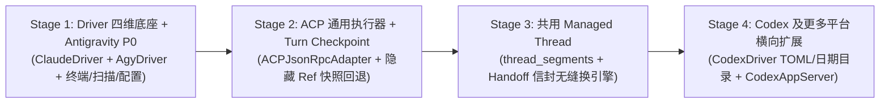

# 多智能体控制面架构深度评估：共用 Thread + Driver/Adapter + Turn Checkpoint

> 状态：**架构深度评估报告**
> 日期：2026-11-18
> 基线分支：`codex/wt-20261118`（提交 `325e9f9`）
> 关联文档：[Antigravity CLI 集成技术方案](antigravity-integration-plan.md)
> 面向范围：Claude Code (`claude`)、Antigravity (`agy`)、OpenAI Codex (`codex`)，以及后续 Gemini CLI / OpenCode / Cursor Agent 等平台扩展。

---

## 1. 总体评估结论

将项目演进为 **「共用 Thread + Driver/Adapter 分层 + Turn Checkpoint」** 架构，**方向完全正确，且高度契合本项目现有的 Swift + SQLite (`WorkStore`) + `WorkspaceService` 代码底座**，不需要推翻重写。

但在面向 **3 个以上异构 CLI 平台** 时，若直接按理想化模型编码，会在 **双写脑裂、跨引擎上下文失真、配置文件异构（JSON vs TOML）、Git GC 回收快照、回退后模型记忆幻觉** 五个地方踩大坑。

| 架构支柱 | 可扩展性评级 | 本项目现有底座复用度 | 核心红利 | 必须守住的设计边界（否则必踩坑） |
| --- | --- | --- | --- | --- |
| **1. 共用 Thread** | ★★★★☆ | 高（`WorkStore` 已有 `works` / `runs` / `run_events`） | 用户面向「任务/话题」而非单一 CLI；中途欠费、限流、卡壳可无缝换引擎接力 | 必须区分 **Virtual Thread（未接力的外部单 CLI 会话，零拷贝扫描）** 与 **Managed Thread（跨引擎/Work 托管会话，SQLite 物化）**，严禁把外部会话全量复制进本地库造成双写脑裂 |
| **2. Driver / Adapter** | ★★★★★ | 中（需从 `Models.swift` / `ClaudeExecutor.swift` 解耦提取） | **协议收敛红利**：结构化执行只需实现 `ClaudeStreamJson`、`ACP`、`CodexAppServer` 三套 Adapter 即可通吃主流生态 | Driver 必须拆成 **发现、终端、配置、结构化执行** 四个正交切面；配置层不能假设全是 JSON（Codex 使用 `TOML`） |
| **3. Turn Checkpoint** | ★★★★★ | 极高（`WorkspaceService.version` 已实现临时 Index + `write-tree`） | 每轮对话代码变更可精确对比、一键安全回退，不污染用户分支与 `git stash` | 必须用隐藏 Git Ref 锚定 `tree` 防 `git gc` 回收；回退代码后必须向 CLI 注入「工作区已回退通知」消除模型记忆幻觉；PTY 模式与结构化模式的快照粒度需诚实区分 |

---

## 2. 多平台真实异构性盘点（为什么简单 `enum + switch` 撑不住）

把 Claude Code、Antigravity、Codex 以及后续 ACP 生态放在一起对比，可以看到它们在**目录拓扑、配置语法、传输协议**上完全不同：

| 维度 | Claude Code (`claude`) | Antigravity (`agy`) | OpenAI Codex (`codex`) | 其他平台（Gemini CLI / OpenCode 等） |
| --- | --- | --- | --- | --- |
| **会话落盘拓扑** | `~/.claude/projects/<编码cwd>/<sid>.jsonl`（按目录聚合） | `~/.gemini/antigravity-cli/brain/<id>/.system_generated/logs/transcript.jsonl` + 索引（按 UUID 聚合） | `~/.codex/sessions/YYYY/MM/DD/rollout-*-<id>.jsonl`（**按日期三级目录聚合**，`cwd` 在首行 `session_meta`） | 各异（SQLite / JSONL） |
| **交互恢复命令** | `claude --resume <sid>` | `agy --conversation <id>` | `codex resume <id>` | 各自 CLI 参数 |
| **配置文件格式** | **JSON** (`~/.claude/settings.json` + `~/.claude.json`) | **JSON** (`~/.gemini/antigravity-cli/settings.json`) | **TOML** (`~/.codex/config.toml`) | JSON / YAML / TOML |
| **MCP 配置形态** | JSON `mcpServers`（支持 stdio / HTTP / 旧 SSE） | JSON `mcpServers`（支持 stdio / Streamable HTTP，**禁旧 SSE**） | **TOML `[mcp_servers.<name>]`** | 多为 JSON `mcpServers` |
| **结构化执行协议** | 私有双向 `stream-json` (`--permission-prompt-tool stdio`) | **标准 ACP** (`agy acp` JSON-RPC 2.0 stdio) 或 `stream-json` | **`codex app-server`** (JSON-RPC stdio) 或 `codex exec --json` | **标准 ACP** (`--acp` / `acp` JSON-RPC 2.0 stdio) |
| **权限/模式模型** | 6 种 `PermissionMode` | 3 种 `--mode` (`auto` / `accept-edits` / `plan`) + `--sandbox` | `approval_policy` (`untrusted` / `on-failure` / `on-request` / `never`) + `sandbox_mode` | ACP 统一审批请求 |

### 关键洞察：结构化协议的「三族收敛」
虽然未来可能要接入 5–8 个 CLI，但在最复杂的 **结构化执行层（Adapter）**，实际上**不需要为每个平台写一套状态机**，行业已经收敛为 3 套传输适配器：
1. **`ClaudeStreamJsonAdapter`**（项目现有的 [ClaudeExecutor.swift](file:///Users/zcl/project/claude-picker/.worktrees/codex-wt-20261118/Sources/ClaudeDeck/Work/ClaudeExecutor.swift) 稍作抽离即可）；
2. **`ACPJsonRpcAdapter`**（基于 Agent Client Protocol 标准 JSON-RPC 2.0 over stdio —— **写一次，同时搞定 Antigravity `agy acp`、Gemini CLI、OpenCode 等所有支持 ACP 的平台**）；
3. **`CodexAppServerAdapter`**（对接 `codex app-server` 的 stdio JSON-RPC 线程/审批流）。

---

## 3. 三大支柱深度拆解与避坑方案

### 3.1 支柱一：共用 Thread（会话统一层）

#### 陷阱 1：全量同步外部历史会话导致的「双写脑裂」与启动卡顿
- **现象**：开发者平时仍会在系统自带终端或 IDE 里直接跑 `claude` / `agy` / `codex`。如果应用启动时把外部所有 `.jsonl` 全量导入本地 SQLite 当成 Thread 缓存，一旦用户在外部继续聊，应用内的缓存立刻陈旧，且几千个文件（尤其 Codex 按年月日分散存储）全量同步会严重拖慢冷启动。
- **架构解法：「Virtual Thread（虚拟线程） + Managed Thread（托管线程）」双态按需物化**
  1. **Virtual Thread（默认态）**：所有由单一 CLI 产生、尚未发生跨引擎切换的普通历史会话，不进 SQLite，继续保持实时流式头尾采样扫描（Claude 按项目目录扫、Codex 按近期日期目录扫并缓存 `file -> (mtime, cwd, title)` 轻量索引）。对外 ID 形如 `claude:<sid>` / `agy:<sid>` / `codex:<sid>`。
  2. **Managed Thread（物化态）**：当且仅当满足以下任一条件时，在宿主 SQLite 创建持久化 Thread：
     - 用户在 Work 中心创建工作项（天然托管）；
     - 用户在某条会话中**切换了引擎**（如从 Claude 切到 Antigravity 或 Codex 继续）。
  3. **绑定表结构（`thread_segments`）**：
     ```sql
     -- 一个公用 Thread 由多段按序排列的底层 CLI Session 组成
     CREATE TABLE thread_segments (
         id TEXT PRIMARY KEY,
         thread_id TEXT NOT NULL,
         seq INTEGER NOT NULL,                -- 第几段（1, 2, 3...）
         provider TEXT NOT NULL,              -- 'claude' | 'antigravity' | 'codex' ...
         provider_session_id TEXT NOT NULL,   -- 对应底层 CLI 的真实 session/conversation ID
         cwd TEXT NOT NULL,
         start_checkpoint_ref TEXT,
         end_checkpoint_ref TEXT,
         created_at TEXT NOT NULL,
         UNIQUE(thread_id, seq)
     );
     ```
     侧边栏检测到某个 `provider + provider_session_id` 已归属某个 `Managed Thread` 时，自动折叠进这一个公用会话条目展示，不会在列表里裂变出三四条碎片会话。

#### 陷阱 2：跨引擎切换时的「隐式状态丢失」与「Token 爆炸」
- **现象**：从引擎 A 切到引擎 B 时，引擎 B 没有引擎 A 的 Prompt Cache、已读文件印象和内部 todo 状态；若把引擎 A 几十轮包含大量 `grep/read` 结果的完整历史拼进首条消息，会直接撑爆引擎 B 的输入窗口并稀释指令注意力。
- **架构解法：标准化的 `<thread-handoff>` 四层交接信封（Handoff Envelope）**
  切换引擎启动新 Segment 时，由宿主从 `run_events`（Work 模式）或旧引擎的 `TranscriptExtractor`（PTY 终端模式）自动组装结构化交接上下文（严格控制在 **16KB–24KB** 以内）：
  1. **任务目标与当前阶段总结**（优先取 Work 目标 + 最近一条 summary / 结论）；
  2. **工作区实时 Git 事实**（当前分支、相对基准的 `git status --short` 与 `git diff --stat`）；
  3. **最近 N 轮（默认 3–5 轮）精简对话流**（完整保留用户的提问与上一任 Agent 的最终文字答复、修改过的文件路径，剔除中间大段工具回显）；
  4. **本地完整历史转录文件指针**（直接附上上一任会话的本地 `.jsonl` 只读路径或宿主导出的临时 `.md` 转录路径 —— 新引擎无论是 `agy`、`claude` 还是 `codex` 都具备本地读文件工具，需要查某处历史细节时可按需读取，既省 Token 又不丢信息）。

---

### 3.2 支柱二：Driver / Adapter 四维解耦分层

为了支持未来快速接入第 4、第 5 个平台（甚至允许某个新 CLI 第一天只支持「原生终端打开」，下周再补「Work 结构化执行」），不能把所有接口塞进一个巨型类，应拆分为 **4 个正交能力协议**：

```text
AgentProviderDescriptor (静态元信息: id, displayName, icon, brandColor)
 ├── 1. DiscoveryDriver   (可选：二进制定位、登录态自检、扫描历史会话、提取 CanonicalTranscript、读 ContextUsage)
 ├── 2. TerminalDriver    (必选：拼装新建/恢复/带 Prompt 的安全参数数组、PTY 忙闲策略、就绪探测与粘贴协议)
 ├── 3. ConfigDriver      (可选：声明 Capabilities 矩阵、独立读写 JSON/TOML 配置、MCP 配置读写映射)
 └── 4. ExecutionAdapter  (可选：结构化非交互执行器，统一输出 ExecutorEvent 供 Work 中心调度)
```

#### 关键设计细节
1. **能力协商（Capability Negotiation）取代前端硬编码**：
   `ConfigDriver` 向前端暴露声明式的 `ProviderCapabilities`：
   ```json
   {
     "provider": "codex",
     "modes": [...],
     "models": [...],
     "efforts": ["low", "medium", "high"],
     "supportsFast": false,
     "supportsHotModeSwitch": false,
     "supportsStructuredWork": true,
     "supportsGraphicalChat": false,
     "supportedMcpTransports": ["stdio", "http"]
   }
   ```
   前端 `Composer.jsx`、`RuntimeBar`、`SessionModal`、`NewWorkModal`、`McpModal` 完全根据这份能力描述渲染控件——加新平台时**前端几乎零改动**。
2. **配置序列化隔离**：
   - `ClaudeConfigDriver`：JSON 原子读写（`~/.claude/settings.json` / `~/.claude.json`）；
   - `AntigravityConfigDriver`：JSON 原子读写（`~/.gemini/antigravity-cli/settings.json` / `~/.gemini/config/mcp_config.json`）；
   - `CodexConfigDriver`：轻量保格式 TOML 键值更新（`~/.codex/config.toml`），绝不强行转成 JSON。
3. **扫描性能优化（应对 Codex 日期目录等离散存储）**：
   在 `~/.local/share/claude-picker/scan-cache.json` 维护一个纯加速用的 `(filePath, mtime, fileSize) -> SessionSummary` 缓存（非真源，文件删了即失效，mtime 变了才重读）。这样即便后续接了 4 个平台、几千条历史记录，启动扫描依然在百毫秒内完成。

---

### 3.3 支柱三：Turn Checkpoint（轮次级代码快照与安全回退）

检查本项目现有的 [WorkspaceService.swift](file:///Users/zcl/project/claude-picker/.worktrees/codex-wt-20261118/Sources/ClaudeDeck/Work/WorkspaceService.swift#L166-L191)，`WorkspaceService.version(of:)` **已经实现了「复制临时 `GIT_INDEX_FILE` → `git add -A` → `git write-tree`」**，能够在不触碰用户真实暂存区（index）的前提下拿到包含未提交和未跟踪文件的完整 Git Tree SHA。这是实现 Turn Checkpoint 最好的基石，但直接拿来作多轮回退还必须补齐 **6 个工程防护**：

#### 防护 1：用隐藏 Git Ref 锚定快照，防止被 `git gc` 回收
- **问题**：单靠 `git write-tree` 产生的 `tree` 和 `blob` 对象没有任何 ref 引用，属于悬空对象（dangling objects），Git 自动后台维护（`git maintenance` / `git gc`）会在一段时间后将其清理，导致历史快照失效。
- **解法**：`write-tree` 之后紧接一步 `git commit-tree <treeSha> [-p <headSha>] -m "cp-checkpoint"`，并写入自定义隐藏命名空间：
  ```text
  refs/claude-picker/checkpoints/<threadId>/<turnSeq>
  ```
  - 因为不在 `refs/heads/*` 和 `refs/tags/*` 下，`git branch`、`git status`、`git log`、日常 `git push` **完全无感、零污染**；
  - Git GC 会将其视为可达对象永久保护，直到该 Thread 归档/清理时由宿主主动删除 `refs/claude-picker/checkpoints/<threadId>/*`。

#### 防护 2：回退代码后的「CLI 记忆幻觉」消除机制（极易被忽视）
- **问题**：第 3 轮 Agent 修改了 `Service.swift`，用户觉得方向错了，点击「回退到第 2 轮结束时快照」。磁盘文件瞬间恢复到了第 2 轮，但如果第 4 轮继续 `--resume` / `--conversation` 同一个底层会话，Agent 的上下文历史里依然认为自己改过 `Service.swift`，下一轮打补丁时就会因行号/内容不匹配报错或反复横跳。
- **解法**：当执行 `revert(to: turnSeq)` 时：
  1. 在宿主事件流写入一条显式的回退记录；
  2. 下一轮向当前 CLI 发送用户指令时，由宿主自动前置注入一段简短的 `<workspace-reverted-notice>`：
     > `[系统同步通知] 用户已将工作目录代码回退至第 #2 轮快照状态（被撤销的变更文件：...）。请以磁盘当前最新文件内容为准，重新读取后再修改，勿依赖此前轮次中的旧文件内容记忆。`
  3. 若用户回退的同时还想连对话历史一起截断，则自动开启一个新的 `thread_segment`（从第 #2 轮之前的对话构建 Handoff 上下文启动新 CLI 会话）。

#### 防护 3：Agent 在轮次中自己执行了 `git commit` 的回退处理
- **问题**：许多 CLI（尤其是 Codex 和全自动模式下的 Claude/Agy）会在一轮任务内自己执行 `git commit` 推进 `HEAD`。若只恢复文件树而不复位 `HEAD`，`git diff` 基线会错乱。
- **解法**：每个 Checkpoint 同时记录 `(head_sha, index_tree_sha, worktree_tree_sha, branch)`：
  - 在**独占 `worktree` 模式**下：先为当前现场创建一个 `undo` 快照（支持误点回退后一键「撤销回退」），若 `HEAD` 仅在本地工作树前进且未推送远端，安全 `git reset --soft <saved_head>` + 恢复暂存区与工作区树 + 清理该轮新增的未跟踪文件；
  - 在**共享 `project` 目录（未隔离）模式**下：严格校验当前工作区 `tree` 是否等于最后一轮结束时的 `after_tree`。如果期间用户自己在 IDE 手写了新代码，**拒绝静默覆盖**，弹出文件级冲突提示让用户确认（延续现有 [WorkCore+Review.swift](file:///Users/zcl/project/claude-picker/.worktrees/codex-wt-20261118/Sources/ClaudeDeck/Work/WorkCore+Review.swift#L84-L86) 的安全防线）。

#### 防护 4：未忽略大文件保护
- **问题**：若仓库未配置好 `.gitignore`（存在几百 MB 构建产物或日志），每轮 `git add -A` 会卡顿并撑大 `.git/objects`。
- **解法**：临时 index 执行前，用 `git status --porcelain -z --untracked-files=all` 过滤掉超过阈值（如单文件 > 20MB）的未跟踪文件（通过 `-- :!<path>` 排除并在快照元数据中标记 `skippedLargeFiles`），且整个快照计算放后台队列。

#### 防护 5：结构化执行 vs 原生 PTY 终端的快照时机诚实划界
- **结构化模式（Work / Adapter）**：在 `turnStarted` 前打 `pre-turn` 快照，`turnResult` 后打 `post-turn` 快照，边界 100% 精确。
- **原生 PTY 终端模式（SwiftTerm）**：没有结构化 RPC 边界。采用**「关键节点自动快照 + 手动快照」**策略：会话启动前、跨 CLI 接力前、终端退出时自动打快照；对话过程中若检测到对应 `.jsonl` 完成一轮落盘且终端空闲超过 2 秒，再增量补打快照，避免在 Agent 正在写文件写到一半时抓出半成品快照。

#### 防护 6：扩展 `ExecutorEvent` 以兼容多平台丰富语义
现有 [ClaudeExecutor.swift](file:///Users/zcl/project/claude-picker/.worktrees/codex-wt-20261118/Sources/ClaudeDeck/Work/ClaudeExecutor.swift#L15-L30) 的 `ExecutorEvent` 主要按 Claude 设计。为容纳 Antigravity (`agy`) 和 Codex，需平滑增加两个可选事件而不破坏现有逻辑：
- `case thinkingDelta(String)`（Antigravity、Gemini、Codex 均支持流式输出推理思考块，前端可折叠展示）；
- `case planUpdated(JSONValue)`（ACP 与 Codex 均支持结构化 Plan/Todo 步骤更新事件）。

---

## 4. 演进路线图（如何分步实施、每一步都可独立交付）

这套架构最大的好处是**可以渐进式长在现有代码上，不需要停机大重构**：



| 阶段 | 核心交付物 | 涉及改动范围 | 完成后获得的能力 |
| --- | --- | --- | --- |
| **Stage 1** | 抽出 `AgentDriver` 注册表 + 增量扫描缓存；实现 `ClaudeDriver` 与 `AntigravityDriver`（发现 + 原生终端 + JSON 配置） | `Sources/ClaudeDeck/Provider/*`（新增）、`Models.swift`、`TerminalPane.swift`、`main.swift`、前端侧栏/弹窗 | 项目树同时展示并管理 Claude 与 Antigravity 会话，原生终端自由切换，参数各自持久化 |
| **Stage 2** | 抽出 `ExecutionAdapter` 协议；实现 **`ACPJsonRpcAdapter`**（接入 `agy acp`）；升级 `WorkspaceService` 落地隐藏 Git Ref **Turn Checkpoint** 与回退幻觉修正 | `Sources/ClaudeDeck/Work/*`、`WorkspaceService.swift`、`WorkStore.swift` (schema v2) | Work 中心支持选 Claude 或 Antigravity 执行；每轮对话可查看单轮 Diff 并一键回退代码；同时自动具备接入任何 ACP 平台的能力 |
| **Stage 3** | 落地 `Managed Thread`（`thread_segments`）+ 四层 `<thread-handoff>` 交接信封 | `WorkStore.swift`、`Store`、前端会话切换引擎入口 | **真正实现「共用会话」**：无论在 Work 还是普通会话，中途可随时从 Claude 切到 Antigravity（或反向）继续同一条任务，侧边栏保持单一会话入口 |
| **Stage 4** | 新增 `CodexDriver`（`~/.codex/sessions/YYYY/MM/DD` 扫描 + `~/.codex/config.toml` 读写）+ `CodexAppServerAdapter` | 仅在 `Provider/Codex/` 新增独立文件并注册到 `DriverRegistry`，主干与前端基本免改 | 零侵入把 Codex（以及 Gemini CLI / OpenCode）拉入同一套共用会话与快照回退体系 |

---

## 5. 最终评估结论与建议

1. **架构可行性**：**高，完全可作为项目的长期核心架构**。它既保留了本项目「macOS 原生轻量 + SwiftTerm 原汁原味 TUI」的护城河，又吸收了 `t3code` 在「会话与底层进程解耦、每轮可回退检查点、标准化适配器」上的精华。
2. **最大投入产出比抓手**：优先把 **Stage 1（`AgentDriver` 四维接口 + Antigravity P0）** 和 **Stage 2 的 `ACPJsonRpcAdapter`** 立住——因为一旦 `ACP` 适配器跑通，后续凡是支持 ACP 标准的 CLI 几乎可以「配置即接入」，只有 Codex 需要额外写一套 TOML 配置与 `app-server` 适配。
3. **下一步动作**：建议就以本评估报告 + [antigravity-integration-plan.md](antigravity-integration-plan.md) 作为技术基线，先执行 Antigravity 的 4 项本机 PoC 探针（约 5–10 分钟命令检查），确认落盘细节后直接启动 **Stage 1** 开发。
